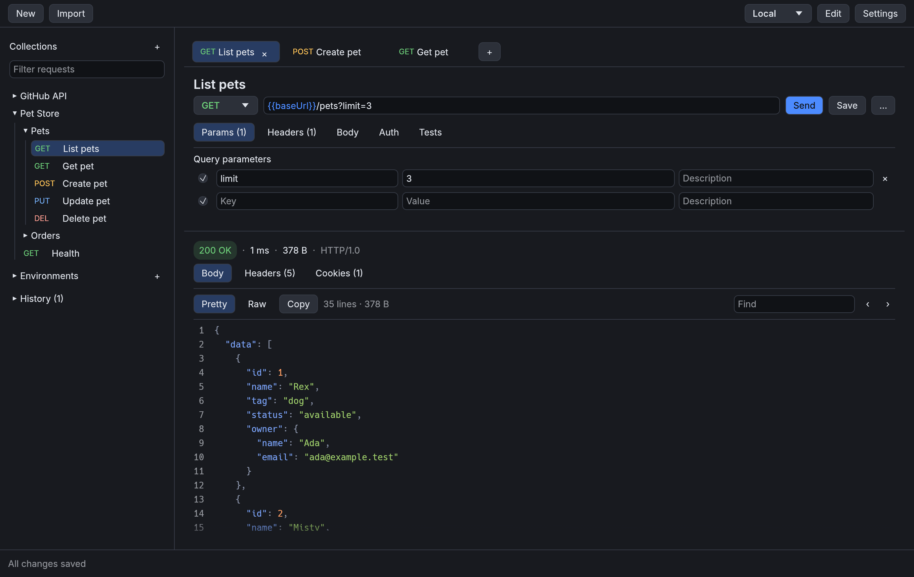
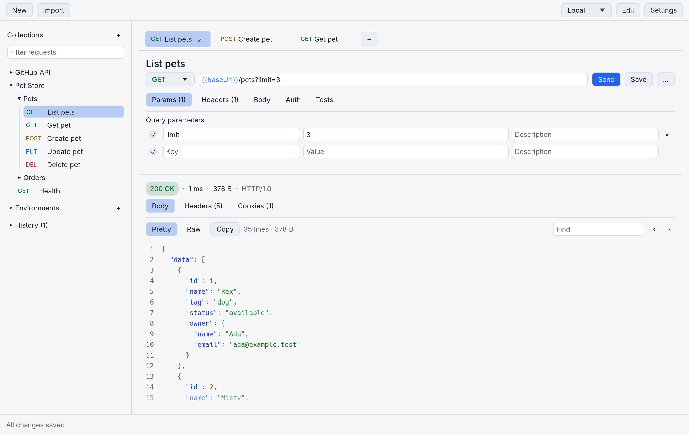
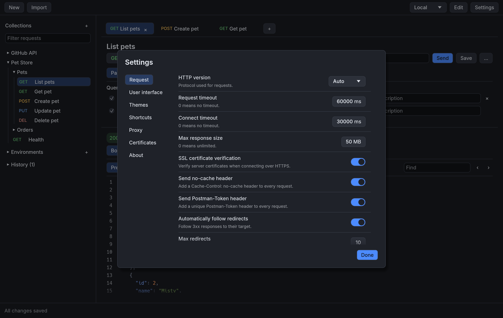

<p align="center"></p>

<h1 align="center">Requestor</h1>

<p align="center">
  A fast, lightweight HTTP client for your desktop and terminal.<br>
  Postman-compatible collections in a fraction of the memory, with no account.
</p>

<p align="center">
  <a href="LICENSE"></a>
  
  
</p>

<p align="center"></p>

## Why Requestor

- **Light.** One native process drawn with [egui](https://github.com/emilk/egui), no browser engine. Five open tabs take about 37 MB; Postman takes about 641 MB. See [Memory](#memory).
- **No account, everything local.** No sign-in, no cloud workspace, no telemetry. Collections, environments and history are plain JSON files on your disk. Secrets go to the system keychain.
- **Git friendly.** Save a collection as a folder with one small JSON file per request, commit it next to your code and review changes as ordinary diffs.
- **Postman compatible.** Collections and environments use the Postman v2.1 formats. Import yours, keep working in either app, and fields Requestor does not know survive the round trip.
- **A real CLI.** The `requestor` binary runs collections with their checks, sends a single cURL or raw request and converts imports, which makes it easy to use in scripts and CI.

## Highlights

- Every HTTP method, with raw (JSON, XML, text), URL-encoded, form-data, file, GraphQL and SOAP bodies.
- Basic, Bearer and API key auth, inherited from the collection or folder. Other Postman auth types are kept as they are.
- `{{variables}}` from environments and collections, with autocomplete, coloring and hover previews.
- Import from Postman, OpenAPI 3, WSDL, cURL and raw HTTP. Paste a cURL command into the URL field to fill in the whole request.
- Scripts before and after each request in a short English language (`expect status is 200`), stored as Postman JavaScript so the same collection runs in Postman.
- WebSocket and server-sent events, response diffs, request history and code generation.
- Proxy with username and password, client certificates, SSL verification, cookies, redirects, timeouts, response size limit and HTTP version, all in Settings.
- Light, dark, midnight and sepia themes, a two-pane view, swappable sidebars, a command palette and keyboard shortcuts for everything.

<table>
  <tr>
    <td></td>
    <td></td>
  </tr>
  <tr>
    <td align="center">Light theme</td>
    <td align="center">Settings</td>
  </tr>
</table>

## Install

On macOS, install or update with one command:

```
curl -fsSL https://raw.githubusercontent.com/muhsincaliskan/requestor/main/scripts/install.sh | sh
```

It puts Requestor in Applications and opens without the "could not verify" warning, because files `curl` downloads are not marked as coming from the internet.

Or download the latest build from the Releases page: a `.dmg` or zipped `.app` for macOS (universal), a `.tar.gz` for Linux or a `.zip` for Windows (the app is `Requestor.exe`, the command-line binary is in `cli\requestor.exe`). On macOS open the `.dmg` and drag Requestor to Applications.

On Linux the file dialogs come from the desktop's file chooser portal (`xdg-desktop-portal`), or from `zenity` when no portal runs. Without either, Choose file does nothing, but you can still drop files onto the window or paste text and addresses into Import.

The macOS app is only ad-hoc signed, so when it comes from a browser download macOS says it "could not verify" Requestor. Click Done, then open System Settings › Privacy & Security and click **Open Anyway** next to the message about Requestor. Or run:

```
xattr -dr com.apple.quarantine /Applications/Requestor.app
```

The `requestor` command-line binary is attached to the same release; run `requestor --help` for usage.

To build the macOS app locally:

```
scripts/bundle-macos.sh
```

This writes `target/bundle/Requestor.app` and, when `hdiutil` is available, `target/bundle/Requestor-<version>.dmg`. Pass both `aarch64-apple-darwin` and `x86_64-apple-darwin` for a universal build.

## Features

- Collections and environments stay compatible with Postman v2.1 JSON. Fields Requestor does not know are kept on export.
- Export a collection as Postman JSON or as one `.http` file with every request, for VS Code REST Client and JetBrains. In the `.http` file, `{{variables}}` stay as placeholders and collection variables are written as `@name = value` lines; secret ones are left out.
- Examples: open a saved request and its examples are listed under it in the sidebar, including the ones in imported Postman collections. Click one to open its request and response in a new tab. **Save as example** next to the response status keeps the current request and response with the saved request, in Postman's format.
- Import from Postman, OpenAPI 3 (JSON), WSDL 1.1, cURL and raw HTTP requests. Paste a cURL command into the URL field to fill in the whole request.
- A WSDL becomes a collection with one ready SOAP request per operation: the address, the SOAPAction (or the SOAP 1.2 action), and a sample envelope with `?` where values go. Each SOAP port gets its own folder. Schemas and WSDLs it imports are read from next to the file. Paste a WSDL address such as `https://host/service.asmx?wsdl` into the import window to download it together with the documents it imports; pasted WSDL text cannot load them.
- Variables:
  - `{{variables}}` resolve from the collection and the active environment.
  - Fields suggest names as you type and color each placeholder: defined in blue, undefined in red.
- SOAP requests:
  - The SOAP body type starts from a 1.1 or 1.2 envelope and has a SOAPAction field.
  - It sends the matching Content-Type.
  - It is stored as raw XML, so Postman opens it unchanged.
- GraphQL: **Fetch schema** asks the server for its schema with the request's URL, headers and auth. The schema's queries and mutations are listed beside the query editor with a filter. Click a field to replace the query with a ready operation that takes its arguments as variables and selects its simple fields. Values already filled in the variables are kept. The schema is kept while the tab is open.
- Scripts on each request, in the **Scripts** tab. See [Scripts](#scripts).
- Secret values are masked in the UI and never logged.
- Secret environment values and the proxy password are kept in the system keychain (macOS Keychain, Windows Credential Manager, the Secret Service on Linux), one entry per environment. The workspace files and every export leave them empty, so a command-line run that reads a workspace environment file sees them empty too. When no keychain is available, or it refuses a value, the values stay in the workspace files and Requestor says so. Secret collection and folder variables are left empty in exports.
- Large responses scroll smoothly:
  - The body view is virtualized and syntax highlighted.
  - It has Pretty and Raw modes for JSON and XML, and a find box.
- Headers and cookies have one-click copy.
- **Copy cURL** next to Save copies the request as a cURL command with secrets as `<redacted>`; Option-click (Alt-click) includes them. **Show code panel** in the **…** menu keeps the code beside the request and updates it as you edit.
- **Generate code** (in the **…** menu next to Save) turns the request into cURL, an `.http` file, JavaScript `fetch`, Python `requests` or Java `HttpClient` code. Secret values show as `<redacted>` unless **Include secrets** is ticked. The last language you picked is remembered. Files the request refers to do not have to exist on this computer. Header values outside ASCII are sent as UTF-8 bytes in the JavaScript and Python code; Java's `HttpClient` accepts only ASCII header values and rejects or replaces the rest.
- Send a request again and the Changes tab shows what differs from the previous response, line by line, with JSON and XML laid out first.
- Server-sent events (`text/event-stream`) show up in an Events tab as they arrive, with each event's type, id and data. Press **Stop** to end the stream and keep what came in. Click an event to copy its data. The last 1000 events are listed. A stream ends at 16 MB, or at the response size limit if that is lower, and stops with a notice when the server stays quiet for longer than the request timeout.
- Client certificates (mutual TLS): Settings › Certificates holds a PEM certificate, and its key when it lives in a separate file, for each host that asks for one. A host can be `api.example.com`, `api.example.com:8443`, `*.example.com` or `*` for every host. A redirect to a host the certificate is not for is not followed, and the redirect response is shown instead. The CLI takes `--cert <file>` and `--key <file>` for `run` and `send`. WebSocket connections do not send client certificates yet.
- WebSocket: a `ws://` or `wss://` URL turns **Send** into **Connect**. Messages in both directions are listed live with their time. Write a message under the list and press **Send** or Cmd+Enter. Binary messages show their size, and clicking a text message copies it. Headers and auth from the request go into the handshake. WebSocket connections cannot use a proxy yet: with a proxy set, only hosts in its bypass list connect. They always verify TLS certificates and do not send stored cookies. The message list keeps the last 1000 messages, up to about 16 MB.
- The History section in the sidebar lists the last 100 requests you sent, with their status. Click one to open it in a new tab that still uses its collection's variables and auth. Sending the same request twice in a row keeps one entry. Request bodies over 32 KB are left out, and responses are never kept. History saves requests as written, including header and auth values, so keep tokens in environment variables. Right-click the History heading to clear it.
- On start, Requestor asks GitHub once whether a newer release exists, and if so shows a link to its download page in the status bar. Turn it off with **Check for updates** in Settings.
- On macOS the status bar also offers **Update to x.y.z**: Requestor downloads the zipped app, checks it against the release's `SHA256SUMS`, replaces itself in place and asks you to restart. On other platforms the link to the release page stays.
- A URL typed without `http://` or `https://` is sent over HTTP, as in a browser.
- With autosave off, requests with unsaved edits are marked in the tree and listed in an Unsaved group at the top of the sidebar.
- A standalone `requestor` command-line binary runs collections, sends single cURL or raw HTTP requests, and converts imports to Postman format.

## Scripts

Each request has a **Before request** and an **After response** script in its **Scripts** tab. Scripts use a small English language that Requestor runs itself, with no JavaScript engine. One statement per line:

```
# After response
expect status is 200
expect time below 500 ms
expect header Content-Type contains "json"
expect json data.items is not empty named "Has items"

if status is 200 and json data.token exists
  save json data.token as token
  save header X-Request-Id as last_id in collection
else if status is 401
  clear token
else
  fail "Unexpected status"
end
```

```
# Before request
set request_id to new uuid in request
set started to timestamp ms
if {{env}} is "prod"
  fail "Do not run this against prod"
end
```

| Statement | Meaning |
| --- | --- |
| `expect CONDITION [named "title"]` | A check. The title shown in results defaults to the condition. |
| `save SUBJECT as NAME [in TARGET]` | Store a value from the response. |
| `set NAME to VALUE [in TARGET]` | Store a fixed or generated value. |
| `clear NAME [in TARGET]` | Remove a variable. |
| `fail "message"` | Stop the script. A failure before the request stops the send. |
| `if` / `else if` / `else` / `end` | Branches, nested as deep as needed. Indentation is only for reading. |
| `# text` | A comment. |

- Subjects: `status`, `time` (ms), `body`, `header NAME`, `json PATH` (for example `data.items[0].id`; `json` alone is the whole body) and `{{variable}}`. Response subjects work only in **After response**.
- Comparisons: `is`, `is not`, `contains`, `not contains`, `above`, `below`, `exists`, `not exists`, `is empty`, `is not empty`.
- Conditions combine with `not`, `and` and `or`, in that order of binding, without parentheses.
- Values: numbers, `true`, `false`, `null`, `"text"` (with `{{variables}}` inside), or `{{variable}}`.
- Generated values for `set`: `new uuid`, `timestamp`, `timestamp ms`, `random number 1 100`, `now iso`.
- Targets: `environment` (the default, or the collection when no environment is active), `collection`, or `request`, which lasts only for this send and is not saved.
- The editor suggests the next word under the editor, and lists mistakes by line. While a script has mistakes, the last saved version keeps running.
- `{{$guid}}`, `{{$randomUUID}}`, `{{$timestamp}}` and `{{$randomInt}}` work anywhere variables do, as in Postman.

Scripts are stored as Postman JavaScript (`pm.test`, `pm.expect`, `pm.environment.set`, …), so the same collection runs in Postman. The **JavaScript** view shows that code:

- **Convert to JavaScript →** shows the JavaScript for the current script.
- You can edit the JavaScript and press **← Convert to script**. Requestor never runs JavaScript, and edits that are not converted are not saved.
- Imported Postman scripts are converted when every line is recognized, including common styles such as `pm.test(...)` with chai assertions, `var jsonData = pm.response.json()`, `postman.setEnvironmentVariable` and `tests["name"] = ...`.
- When a line is not recognized, the script does not run. The Scripts tab lists the lines it could not convert, and the original JavaScript is kept unchanged on save and export.

## Using the same data on several computers

Settings › Data shows the folder where Requestor keeps collections, environments, history and settings. Choose a folder that Git, Google Drive or Dropbox syncs, and Requestor uses it after a restart. An empty folder gets a copy of your current data; a folder that already holds Requestor data, for example one synced from another computer, is used as it is. Secret environment values and the proxy password stay in each computer's keychain and are not synced, so enter them once on every computer. Everything else is synced as it is written: tokens typed directly into requests or collections, the request history and saved examples. Keep tokens in secret environment variables, and keep the synced folder private. Collections saved to their own folder with **Save to folder…** are linked by their path on this computer, so link them again on the others.

Run one copy of Requestor on the synced folder at a time, so two computers do not overwrite each other's changes.

## Keeping a collection in git

Right-click a collection and choose **Save to folder…** to keep it in a folder you pick, for example inside your project's repository. Every request becomes its own small JSON file, so changes show up as clear diffs and merge cleanly:

```
api/
  collection.json        name, variables, auth and the order of the items
  health.json            one file per request
  orders/
    folder.json          the folder's settings and the order of its requests
    list-orders.json
```

- File names come from the request names. Requests a teammate adds as new files are picked up on the next start.
- Only files Requestor wrote are ever changed or removed. Other files, such as a README or a `package.json`, are left alone: a request whose name matches one is saved as `name-2.json` instead. Linked directories are not followed.
- Values are saved as written, so keep tokens and passwords in an environment rather than in the collection you commit.
- **Open collection folder…** in the import window opens a folder someone else saved.
- **Stop saving to folder** keeps the files and moves the collection back into the app's own storage. Deleting the collection in the app also leaves the folder alone.
- `requestor run api/` runs a saved folder just like a collection file.

## Keyboard shortcuts

`Cmd` is `Ctrl` and `Option` is `Alt` on Linux and Windows.

| Action | Keys |
| --- | --- |
| Command palette: run a command, open a request, switch environment or theme | Cmd+K |
| Send request | Cmd+Enter |
| Save request | Cmd+S |
| New, close, duplicate tab | Cmd+T, Cmd+W, Cmd+D |
| Next, previous tab | Ctrl+Tab, Ctrl+Shift+Tab |
| Find in response | Cmd+F |
| Import | Cmd+O |
| Generate code | Cmd+Option+G |
| Settings | Cmd+, |
| Toggle sidebar | Cmd+B |
| Toggle two-pane view | Cmd+Shift+L |
| Show middle workbench | Cmd+Option+M |
| Swap left and right sidebars | Cmd+Option+S |

## Command line

```
requestor run collection.json --env dev.json --folder Pets
requestor run api/ --env dev.json
requestor send "curl -X POST https://example.test/pets -d '{\"name\":\"Rex\"}'"
requestor import openapi.json --to postman
requestor import service.wsdl --to postman
requestor import "https://host/service.asmx?wsdl" --to postman
```

`run` evaluates the checks saved with each request and passes values extracted from a response to the requests after it. A failed check fails the request.

Run `requestor --help` for every option. The exit code is 0 when every request succeeded, 1 when one failed and 2 for usage or input errors.

## Layout

- `crates/core`: HTTP engine, collection and environment models, variable resolution, importers and exporters. No UI dependencies.
- `crates/cli`: the `requestor` command-line binary.
- `crates/app`: the egui desktop application.

## Development

```
cargo fmt --all -- --check
cargo clippy --workspace --all-targets -- -D warnings
cargo test --workspace
```

## Memory

Memory use is measured on macOS as the physical footprint, which is what Activity Monitor shows. Requestor runs as a single process; for Postman the main, renderer and GPU processes are added together.

| Scenario | Requestor | Postman 11.99 |
| --- | --- | --- |
| Idle, one collection, 5 open tabs | about 37 MB | about 641 MB |
| 8 open tabs, 5 MB JSON response loaded | about 57 MB | not measured |

The CI memory job runs both scenarios on macOS. The budget is 120 MB for the first and 180 MB for the second, and 200 MB is the hard limit.

### Measuring it yourself

```
scripts/measure-ram.sh 5 0 120
scripts/measure-ram.sh 8 5 180
```

The arguments are the number of open tabs, the size of the response loaded into the active tab in megabytes, and the budget in megabytes. A footprint over the budget is reported as a warning; over 200 MB the script fails. On macOS it reports the physical footprint, which is what Activity Monitor shows. To compare with Postman, add up every Postman process (main, Helper renderer and GPU) and compare the total with Requestor's single process.

## Fonts

The interface uses [Inter](https://github.com/rsms/inter) in Regular, Medium and SemiBold, reduced to the Latin and interface symbol ranges. Inter is licensed under the SIL Open Font License 1.1; see `assets/fonts/LICENSE-Inter.txt`.

## Roadmap

Planned and considered work is in [docs/ROADMAP.md](docs/ROADMAP.md).

## Code signing policy

Windows builds are signed. Free code signing provided by [SignPath.io](https://about.signpath.io), certificate by [SignPath Foundation](https://signpath.org). See the [code signing policy](docs/CODE_SIGNING.md) for team roles and the privacy statement.

## Contributing

Bug reports, ideas and pull requests are welcome. See [CONTRIBUTING.md](CONTRIBUTING.md) for how to build, test and propose a change.

## License

Requestor is released under the [MIT License](LICENSE).
